# FortiGate NGFW: Layer 7 App Control & Advanced Traffic Auditing

---
## Overview

This project is the **second lab** in my FortiGate lab series. Building upon the network segmentation and stateful firewall rules established in Lab 1 [Fortigate DMZ and Segmentation Lab](https://github.com/EspoirBlack/fortigate-dmz-segmentation-lab), this project demonstrates how to configure a Next-Generation Firewall (NGFW) for advanced threat detection.

The core objective was to move security monitoring beyond basic Layer 4 (port-based) filtering to *Layer 7 (Application Control)*, while configuring the firewall to capture aggressive reconnaissance traffic (Nmap scans). This proves how an enterprise security team can gain deep visibility into attacker footprints and block evasive malware that tries to hide on standard allowed ports.

## Network Architecture & Topology

The lab environment is structured with distinct security zones to simulate an enterprise network:

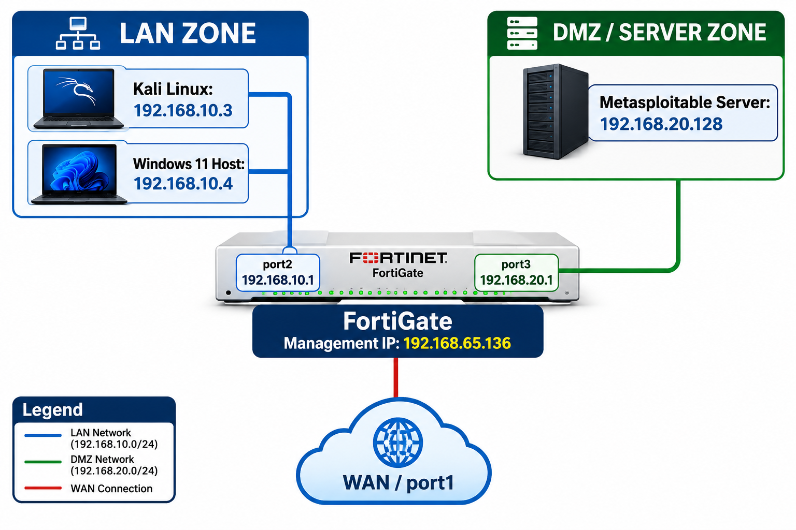
---
## Core Configurations & Security Logic
1. Traffic Visibility & Log Upgrades (Layer 4 Auditing)
`What I did`: I modified the existing ***LAN-to-DMZ*** firewall policy to capture All Sessions instead of just security events. I then fired an aggressive Nmap scan (***nmap -sS -A -v***) from Kali Linux (`192.168.10.3`) directly at Metasploitable (`192.168.20.128`).

`Why I did it`: By default, enterprise firewalls only log dropped packets or critical threats to keep their hard drives from filling up. However, during network reconnaissance, attackers send packets that look perfectly normal to standard rules. Forcing the FortiGate to log everything allowed me to track the attacker's full footprint in `Log & Report > Forward Traffic`.

`Real-World Benefit`: A security breach doesn’t happen out of nowhere; it is preceded by reconnaissance. Attackers spend hours scanning for open ports like MySQL (3306) or HTTP (80). By tracking all sessions, an engineer can spot an anomaly a single internal IP suddenly establishing 500 connections to sequential ports in seconds. This provides early warning detection before an exploit is even launched.

2. Deep Packet Inspection & Layer 7 Application Control
`What I did`: I enabled Application Control inside the firewall policy. This moved security monitoring from simple port tracking (Layer 4) to true Application Recognition (Layer 7).

`Why I did it`: Attackers are clever. If they know a firewall blocks port 3306 (MySQL) but allows port 80 (Web), they will modify their hacking tools to communicate using port 80. If your firewall only checks port numbers, it will blindly trust the traffic. By turning on Application Control, the FortiGate looks inside the payload to verify that the traffic actually matches the expected service protocol.

`Real-World Benefit`: Imagine a compromised laptop in the office (`192.168.10.x`). Malware tries to steal data by opening an encrypted tunnel back to a command server, hiding the traffic inside Port 443 (normally HTTPS). A legacy firewall lets it slip past. A FortiGate running Application Control inspects the pattern, identifies that the application is actually a forbidden proxy or known malware agent, and blocks it regardless of the port number used.

3. Stateful Traffic Flow Rules (The Reason Nmap Worked)
`What I did`: I verified that even though `Metasploitable (192.168.20.128)` has a zero-trust policy blocking it from initiating a connection into the corporate network, `Kali Linux (192.168.10.3)` could still perfectly scan it and receive data back.

`Why I did it`: This solidifies the understanding of a Stateful Firewall Engine. Because the Kali machine started the handshake, the FortiGate opened a temporary lane in its internal dynamic session table. When Metasploitable replied to the scan, the FortiGate matched the reply to the open session and let the traffic through.

`Real-World Benefit`: This allows network architects to build high-security infrastructure. The IT team can connect to, manage, and patch production databases in the data center safely. Yet, if one of those databases is completely compromised by a web exploit, the database server itself cannot turn around and launch an attack against your office PCs because the firewall drops any uninitiated outbound traffic.

## Verification & Evidence
1. The Reconnaissance Attack
Kali Linux executing an aggressive Nmap scan against the DMZ server.
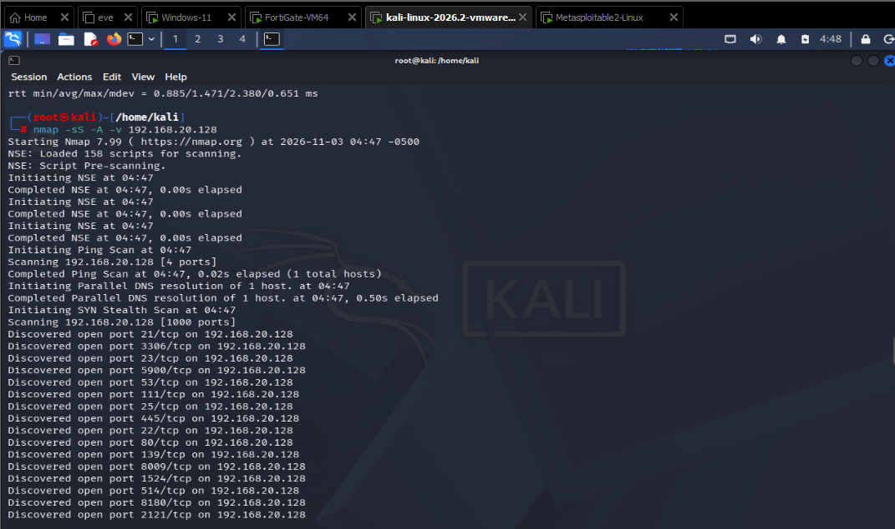
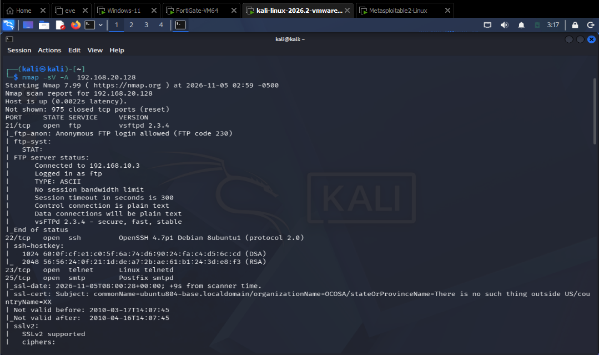

2. Layer 4 Log Auditing (All Sessions)
By capturing all sessions, the FortiGate logs every single packet generated by the scan, showing thousands of hits in the Forward Traffic log.
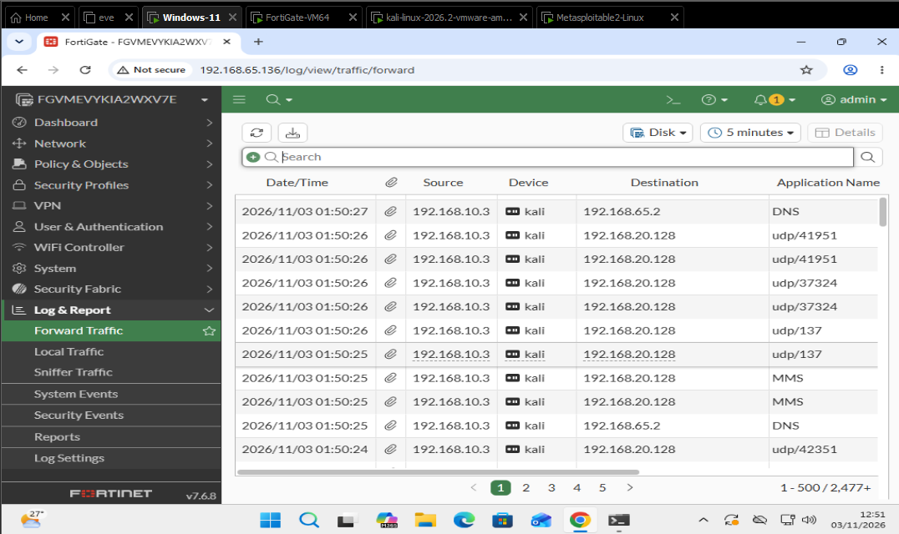
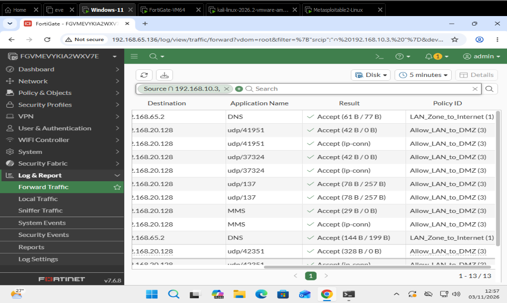

3. Layer 7 Application Control Recognition
The FortiGate successfully identifies the specific applications being used during the scan, even when they use standard ports. Notice the detection of VNC, SSL, Telnet, and JavaRMI.
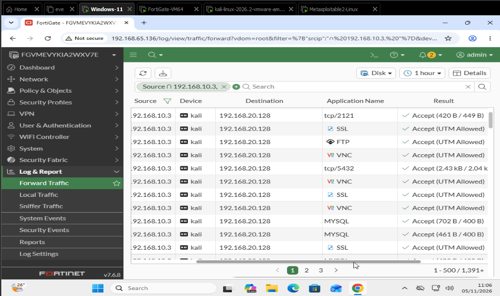
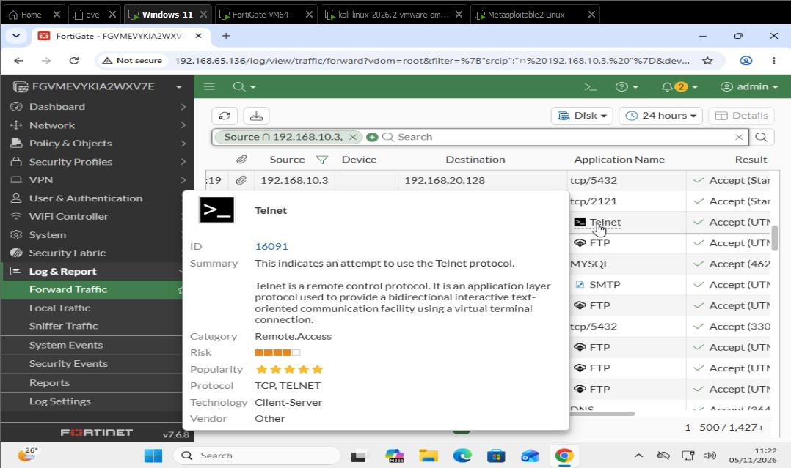
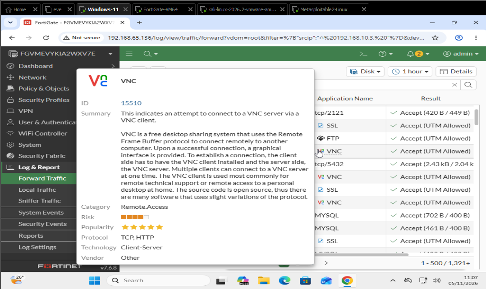
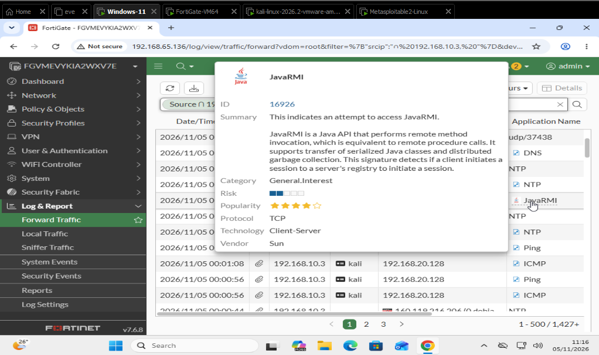

4. Dashboard & Threat Analytics
The FortiGate dashboard and FortiView visualize the Nmap scan, flagging the Kali Linux machine as a high-threat source due to the sheer volume of connections and identified applications.
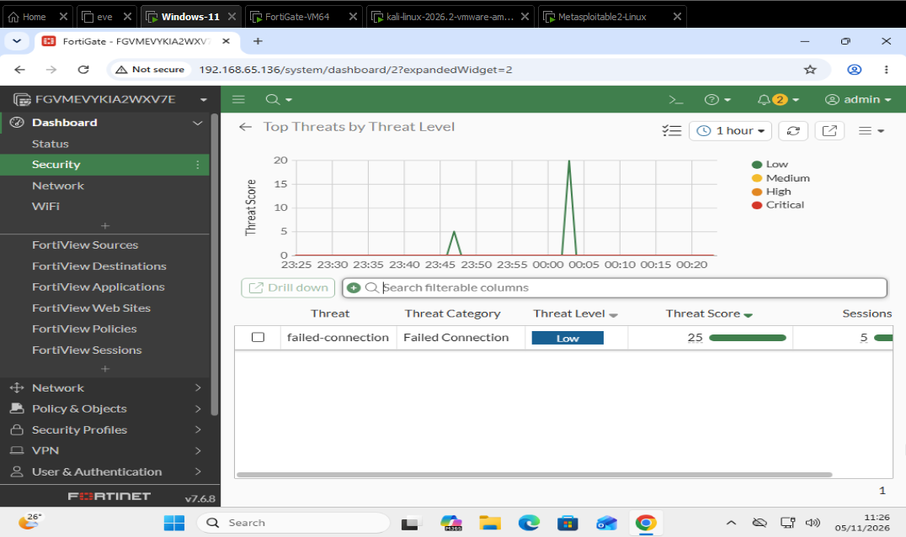
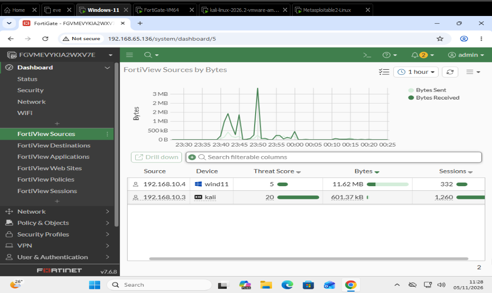
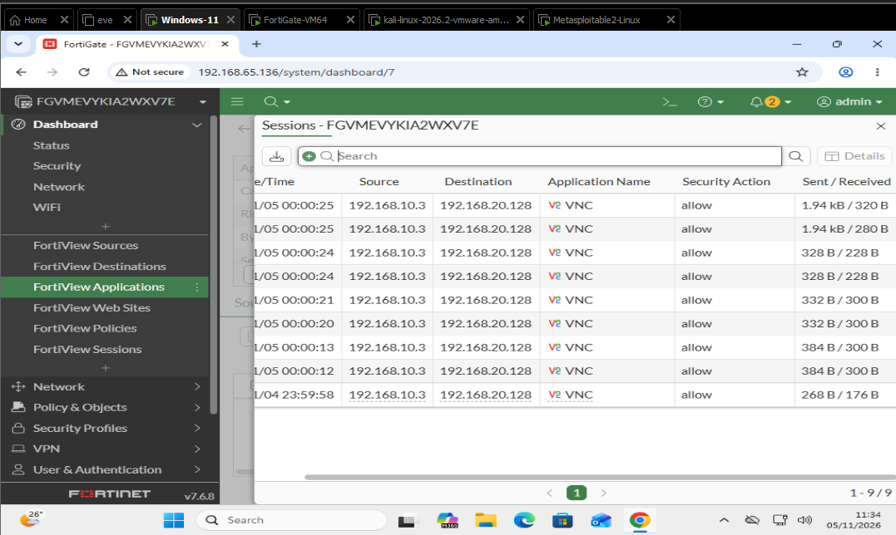
---
## Lessons Learned
`The Power of "All Sessions" Logging`: I learned how to properly configure logging to capture reconnaissance. It's incredible how much data an Nmap scan generates, and how useful it is to be able to filter it down by specific Application Name or Source IP in the FortiGate logs.

`L7 vs L4 Inspection`: Seeing the FortiGate identify VNC traffic (which can run on various ports) and Telnet traffic proved exactly why Application Control is essential. It identifies the intent of the traffic, not just the port number.

Security Engine Synergy: A stateful firewall allows the Nmap scan to work (because the LAN initiated it), but Application Control logs and categorizes it. This synergy between features provides immense visibility without breaking functionality.
---
## Author
Mumbere Espoir

Focused on Network Security, Firewalls, and Infrastructure Hardening
---
*Disclaimer: This project was built in an isolated virtual lab for educational and defensive security purposes only.*